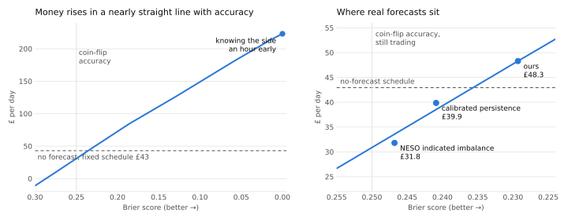
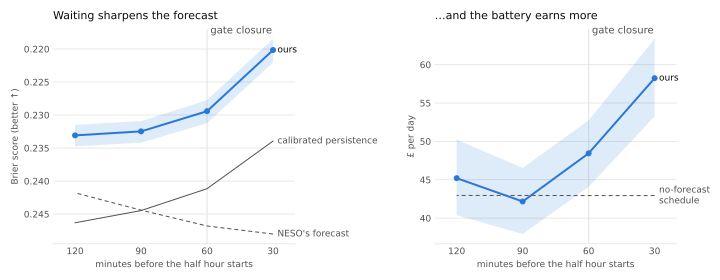
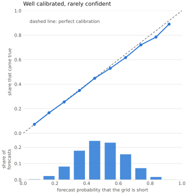
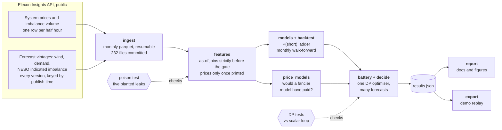

# Gate Closure

[](https://github.com/ekjots1ngh/gate-closure/actions/workflows/ci.yml)

**Forecasting the GB grid's imbalance one hour ahead, and pricing what that forecast is worth.**

Every half hour the GB electricity system is either short of power or long. Whoever is on the wrong side pays the imbalance price, which nobody knows until about twenty minutes after the half hour ends. One hour before each half hour, at gate closure, we forecast which side the grid will be on, using only data that was public at that moment. A simulated 1 MW / 2 MWh battery trades on the forecast.

Built in 24 hours at OxHack '26 (Oxford, 24 to 25 October 2026) for HRT's challenge: *best use of data for predictions and decision making*. The theme of the hack was time; this project is about the one hour between deciding and knowing.

## The answer

Walk-forward over four years (July 2022 to June 2026, refitted monthly, 70,120 half hours), with 90% intervals from resampling whole weeks:

- **The forecast is clearly better than the baselines.** Our probability of a short system scores Brier 0.2294. Calibrated persistence scores 0.2412 and NESO's own published imbalance forecast 0.2468. Paired over the same weeks, ours is better by 0.0117 [0.0107, 0.0128].
- **It is worth a little money, and we can say exactly how much.** The battery earns £42.9 a day on a fixed daily schedule and £48.4 with our forecast: a gain of £5.5 a day [1.2, 9.8]. Persistence and NESO's forecast both lose money against the schedule.
- **There is an exchange rate between accuracy and money.** Scale the forecast's errors up or down and the money moves almost linearly: £8 to £10 a day per 0.01 of Brier. The line crosses the no-forecast schedule at about Brier 0.236. Trading on a coin-flip-quality forecast loses £13 to £19 a day against simply not forecasting. So the first slice of skill only pays for the right to act on a forecast at all. That is why a clearly better forecast earns only £5.5 more. In the language of forecast verification, ours is almost perfectly calibrated but has low resolution: it rarely strays far from 50/50.

<picture>
  <source media="(prefers-color-scheme: dark)" srcset="docs/value_of_skill_dark.svg">
  
</picture>

For scale, knowing the side of every half hour an hour early would earn £223 a day, and knowing every price in advance £345. A boosted-tree classifier beats our logistic model on Brier (0.2266) but not on money (£47.4 a day against £48.4; it moves by up to £2 between machines), so the simple model ships. Forecasting the price directly earns less than the fixed schedule.

Every table, interval and robustness check is in [docs/RESULTS.md](docs/RESULTS.md), generated from the pipeline's output.

## Out of sample: the sealed holdout

July to 23 October 2026 was sealed until after the freeze and opened once, with the walk-forward's own recipe ([docs/HOLDOUT.md](docs/HOLDOUT.md), 5,520 half hours):

- **The forecast held.** Ours scores Brier 0.2319, against 0.2417 for calibrated persistence and 0.2466 for NESO's forecast. The pre-registered failure condition was that ours would not beat persistence outside the 90% interval; it does, by 0.0097 [0.0059, 0.0144].
- **The money did not.** In these months the fixed schedule earned £86.0 a day, twice its four-year average, as price spreads hit records. With our forecast the battery earned £71.9: a loss of £14.1 a day [4.1, 25.7] against the schedule. The value-of-skill curve says why: against a schedule that strong, a forecast needs Brier about 0.21 to pay, and ours is 0.232. The skill was real; this summer it was not enough.

## What is an hour worth?

Gate closure is fixed at an hour by the market's rules, and NESO's 2026 consultation on balancing reform recorded calls to move it to 30 minutes. Every timing rule here is one constant, so [`gclose/latency.py`](gclose/latency.py) reruns the four-year walk-forward with the decision 30, 60, 90 and 120 minutes before each half hour, moving the newest visible price with the gate, and runs the poison check at every lead (all pass; the 60-minute run reproduces the headline to every digit).

| decided before the half hour | 120 min | 90 min | **60 min (the rule)** | 30 min |
| :--- | ---: | ---: | ---: | ---: |
| Brier, ours | 0.2331 | 0.2325 | **0.2294** | 0.2202 |
| £ a day, ours (schedule £42.9) | 45.2 | 42.2 | **48.4** | 58.2 |
| gain over the schedule, £ a day | 2.2 [-2.6, 7.3] | -0.8 [-5.0, 3.6] | **5.5 [1.2, 9.8]** | 15.3 [10.3, 20.4] |

Deciding half an hour later is worth £9.8 a day more to this battery [7.1, 12.8], paired by week. The gain holds where print times are exact (first prints, to January 2024): £22.9 a day over the schedule at 30 minutes [11.8, 34.0], against £9.9 at 60. Money at 120 and 90 minutes is noisier than the Brier score, which worsens steadily with distance. Further from delivery than an hour, the edge is gone. This is an analysis added after the results ([amendment 10](PROTOCOL.md#amendments)), not a change to any model.

<picture>
  <source media="(prefers-color-scheme: dark)" srcset="docs/value_of_time_dark.svg">
  
</picture>

## The maths, and what each piece does

| Concept | Where you meet it | What it does here | What it showed |
|:---|:---|:---|:---|
| Logistic regression, fitted by maximum likelihood | 2nd-year statistics | Turns 16 gate-safe features into P(short) | Brier 0.2294, against 0.2412 for persistence |
| Proper scoring rules: Brier score, log loss | 3rd-year statistics | Scores probabilities so that honest forecasting is the best strategy | A coin is 1 bit; ours is 0.9379, so it extracts 0.06 bits per half hour |
| Murphy's decomposition, reliability diagram | Forecast verification | Separates calibration from resolution | Calibration near perfect (0.0003); resolution 2.2 times persistence's, but only 8% of the uncertainty |
| Block bootstrap; Diebold-Mariano with Newey-West variance | Time series, econometrics | Honest uncertainty when errors are autocorrelated: weeks are resampled whole, and the variance allows a week of lags (336 half hours) | Ours beats persistence by 0.0117 [0.0107, 0.0128]; Diebold-Mariano statistic -17 |
| Law of total expectation, certainty equivalence | Probability, optimal control | E[price] = p × (price when short) + (1 - p) × (price when long). Cash is linear in price and the battery is too small to move it, so for the half hour being traded this one number is all the optimiser needs | Why a calibrated probability is enough: it maps straight to the expected price |
| Dynamic programming: Bellman equation, backward induction | Algorithms, optimisation | Values every state of charge and re-plans each half hour (model predictive control) | Vectorised over 70,120 half hours: the whole study runs in seconds |
| Two-state Markov chain | 2nd-year probability | Carries the forecast forward, fading at the side's own persistence | Tested, and too simple: the grid's memory decays more slowly than geometric. Fixing it is worth about £1 a day |
| Expected value of information | Decision theory | Prices accuracy in pounds, with two ceilings | £8 to £10 a day per 0.01 of Brier; knowing the side £223 a day, hindsight £345 |
| Sharpe ratio, information ratio, drawdown | Finance | Risk-adjusted view of the gain over the schedule | Information ratio 0.53 a year: real, but noisy |
| Point-in-time as-of joins (a sorted merge), walk-forward testing | Algorithms, quant practice | No input is ever used before it was public | Poison check on a real week: 0 of 170 decisions change |
| Mutation testing | Software engineering | Proves the leak test can actually fail | 5 leaks planted, 5 caught |

<picture>
  <source media="(prefers-color-scheme: dark)" srcset="docs/reliability_dark.svg">
  
</picture>

## One decision, in time

```
   T-150    T-120     T-90     T-60     T-30       T      T+30
     │  t-5   │  t-4   │  t-3   │  t-2   │  t-1   │   t    │
     └────────┴────────┴────────┼────────┴────────┴────────┘
                                ▲
                                gate closure: the decision for period t is made here

     t-4's price prints about 52 min after it starts (T-68)    used
     t-3's price prints about 52 min after it starts (T-38)    not yet public, never used
     wind, demand and NESO forecasts                           newest version published strictly before T-60
```

Everything in the project bends around this picture. A feature is either provably public at the gate or it does not exist.

## Architecture



### Design decisions

1. **One clock.** Every timing rule (the gate, the price lag, when prices print) is a named constant in [`gclose/__init__.py`](gclose/__init__.py), shared by the features, the training windows, the optimiser and the tests. There is no second definition to drift.
2. **Point-in-time by construction.** Forecast vintages join with a single `merge_asof` per dataset, matched to their own target period and strictly before the gate. Prices are used only once they have printed. Each monthly refit learns only from outcomes that were public at that month's first gate.
3. **One optimiser, many forecasts.** The battery's dynamic programme is fixed, and forecasts are swapped in. So a difference in money is the forecast's doing, not the optimiser's. Fed only the base rate, the forecast-driven policy takes exactly the schedule's actions on all 70,120 half hours, and a test pins that identity.
4. **Vectorise what does not depend on the path.** The value of each state of charge depends only on prices, so the Bellman step runs across every half hour at once in numpy. Only the battery's path, with its daily loss limit, is a loop. The feature build went from 123 s to 12 s and the whole decision study runs in 5 s, each checked to reproduce the slower version's output exactly.
5. **Uncertainty on every headline.** Intervals resample whole weeks, because a windy week is windy all week. Comparisons are resampled in pairs, so an interval describes the difference, not two independent noises.
6. **Tests that try to break it.** The poison test replaces everything published after a cutoff with noise, with a cutoff one minute before every publication, and checks that nothing decided earlier changes. To prove it can fail, it also plants five leaks (late prints ignored, a one-period price lag, gates at 45, 30 and 0 minutes) and requires each one to be caught.

## Honesty

- **Pre-registered.** [`PROTOCOL.md`](PROTOCOL.md) fixed the question, baselines, battery, metrics and failure condition before any result existed. Every later change is a dated amendment saying what changed, why, and its effect, including the ones found by an independent code review.
- **Held out.** July to 23 October 2026 was sealed. `python -m gclose.holdout` opened it once, after the freeze, with the walk-forward's own recipe, and refuses to run a second time. It was opened on Saturday evening rather than Sunday morning ([amendment 9](PROTOCOL.md#amendments)); the result is above, including the part that went against us.
- **Live.** From the freeze, `python -m gclose.live run` decides every half hour and pushes each decision to [`ledger/decisions.jsonl`](ledger/) six minutes before that half hour's gate, once the newest price has normally printed. The frozen model is [plain JSON](ledger/model.json) with a SHA-256 of its contents, and every line carries that hash, so anyone can recompute any decision. GitHub's timestamps are the receipt. Some lines came from old code: after the fix in [amendment 8](PROTOCOL.md#amendments) the first process kept running beside the fixed one for a while (from the 18:30 UTC half hour on 24 October), reading the unprinted newest period as long. The ledger is append-only, so those lines stay. They carry the bug's signature, a side for the newest period although its volume had not printed, and `python -m gclose.live score` leaves them out and lists them.
- **Known limitation.** From February 2024 Elexon serves each price as revised the next day, and the first print is not kept. In that era our price-based inputs use revised values that were not public at the gate (the timing rule itself is still enforced). We report both eras: before the switch, with clean first prints, ours beats the schedule by £9.9 a day and persistence by 0.0129 Brier; after it, by £2.6 and 0.0110.
- **Reproducible.** The raw data is committed, so every number rebuilds offline. Two machines agree to the decimal on everything except the boosted model, which moves by up to £2 a day with floating-point differences in tree building.

### The live record, line by line (to Sunday 05:30 UTC)

All times UTC. GitHub's push time comes from the repository's activity log, which we cannot edit.

| half hour | gate | decided | on GitHub | counted? |
| :--- | :--- | :--- | :--- | :--- |
| 24 Oct 18:00 | 17:00 | 16:52 | 16:52 | yes |
| 24 Oct 18:30, 19:00, 19:30, 20:00 | 17:30 to 19:00 | 17:02 to 18:32 | before each gate | no: the old process, with the bug fixed in amendment 8 |
| 24 Oct 19:30 (second copy) | 18:30 | 18:07 | 18:16 | yes: the fixed process |
| 24 Oct 20:30 | 19:30 | 19:24 | 19:41 | counted, but reached GitHub 11 minutes after its gate: two processes' pushes collided |
| 24 Oct 21:00 | 20:00 | 19:54 | 19:54 | yes |
| 24 Oct 23:00 | 22:00 | 21:32 | 05:19 next day | no: the laptop slept mid-decision |
| 25 Oct 06:30 | 05:30 | 05:24 | 05:24 | yes |

The gap from 21:30 on Saturday to 06:00 on Sunday is the laptop asleep. Running it for a day proved the machinery (the frozen model, the six-minute lead, the receipts) and found three real operational failures, each now handled in code. It says nothing yet about skill; that takes months of lines.

## Fine print

- **What gate closure means here.** In GB, gate closure is one hour before each half hour: physical notifications lock and NESO takes over balancing. Trading itself can continue until the half hour starts (BSC modification P342). We model a battery whose physical position is fixed at gate closure, which is when its exposure to the imbalance price is decided. NESO's 2026 call for input on balancing reform recorded calls to move gate closure to 30 minutes, so how much an hour is worth is a live question.
- **This is NIV chasing.** Trading on the expected direction of the system imbalance has a name. NESO's study of it (by FTI Consulting) found it reduces the GB-wide imbalance but can worsen local imbalances behind transmission constraints, and batteries increasingly set the marginal balancing price themselves. We model a 1 MW price-taker; at fleet scale this edge would be competed away.
- **Skill against the base rate.** Always quoting the base rate scores Brier 0.2495 (the uncertainty term of the decomposition). Ours is 8.1% better (Brier skill score 0.081), persistence 3.4%, NESO's forecast 1.1%.
- **How the value-of-skill curve is made.** Each probability is moved towards or away from the outcome, p_k = clip(y + k(p - y), 0, 1), and the same optimiser trades on it: k = 1 is our forecast, k = 0 knows the side, k > 1 is worse than ours. Other ways of degrading a forecast could give a different slope.
- **What the live record can and cannot show.** A day of half hours proves the process: a frozen model, inputs public at the gate, every call on GitHub before its gate. It is far too short to prove skill; the four-year walk-forward and the holdout do that.

## Demo

[`web/dist/index.html`](web/dist/index.html) is the whole demo in one file, data and fonts included: download it and open it in a browser, no install and no network needed. It replays one week of 2026 (the week with the widest range of prices, chosen without looking at the money) as the control room would have seen it. Prices print about 52 minutes after each half hour starts, the forecast's lamps light at each gate, the battery trades, and the wind map shows the forecast revisions the model saw. **Poison the future** (key P) replaces everything published after a cutoff with noise and shows that no decision before it moves. Below the replay, a slider scales the forecast's errors to show what skill is worth, and the live record is read straight from this repository.

To rebuild it: `python -m gclose.export`, then `cd web && npm install && npm run build`.

## Reproduce

Python 3.11 or later, any OS. About three minutes from a clean clone, with no network: the raw data is in the repo.

```
pip install -e ".[dev]"            # or: pip install -r requirements.txt
make reproduce                     # or run the lines below in order

python -m pytest -q                # 36 tests, about 15 s
python -m gclose.features          # gate-safe feature table from data/raw (12 s)
python -m gclose.backtest          # walk-forward forecasts, Brier and log loss
python -m gclose.price_models      # the boosted and ridge checks (1.5 min)
python -m gclose.decide            # the battery under every forecast, with intervals
python -m gclose.report            # docs/RESULTS.md and the figures
python -m gclose.export            # demo data, and the poison check on a real week
```

`make lint` runs ruff's linter and formatter check. To refresh the data from Elexon (public API, no key):
`python -m gclose.ingest check`, then `python -m gclose.ingest pull 2022-01-01 2026-10-23`.

## Repository

```
PROTOCOL.md              the pre-registration and its dated amendments
gclose/__init__.py       everything the protocol fixes: paths, timing rules, test windows
gclose/ingest.py         Elexon client and raw store: monthly parquet under data/raw/, resumable
gclose/features.py       gate-safe features: as-of joins for forecasts, print times for prices
gclose/models.py         the P(short) ladder: coin, persistence, NESO's forecast, ours
gclose/backtest.py       the walk-forward driver, and forecast scores
gclose/price_models.py   would a fancier model have paid? ridge and boosted, same driver
gclose/battery.py        the battery: vectorised dynamic programme, sequential path
gclose/decide.py         one optimiser, many forecasts: money, ceilings, robustness, value of skill
gclose/stats.py          bootstrap, scoring rules, Murphy's decomposition, Diebold-Mariano, risk
gclose/receipts.py       the poison check end to end on a real week
gclose/report.py         docs/RESULTS.md and the figures, rendered from results.json
gclose/figures.py        README figures in light and dark
gclose/live.py           the frozen model and the live record: check, freeze, run, score, replay
gclose/holdout.py        opens the holdout, once
gclose/latency.py        what an hour is worth: the walk-forward at four decision times
gclose/export.py         replay data for the demo
gclose/store.sql         a TimescaleDB sketch for the Tiger Data track (not used by the pipeline)
tests/                   the poison test with planted leaks; the optimiser against a scalar loop
data/raw/                Elexon data, January 2022 to October 2026
ledger/                  the frozen model and every live decision, as pushed
web/                     the demo: a replay at gate closure; dist/index.html is the built page
```

## Data and licence

Elexon Insights API: `/balancing/settlement/system-prices/{date}` for prices and net imbalance volume, and `/datasets/WINDFOR`, `/datasets/NDF` and `/datasets/IMBALNGC` queried by publish window for forecast vintages. Contains BMRS data © Elexon Limited copyright and database right 2026, used under the BMRS Data Licence.

Prior work by the author (an RMT spurious-factor paper, a systematic-trading repository) is cited for context only; no code from it is used. Nothing from Cabestan Quant Research is used.

The code is MIT licensed (see [LICENSE](LICENSE)); the Elexon data in `data/raw/` stays under the BMRS Data Licence.
