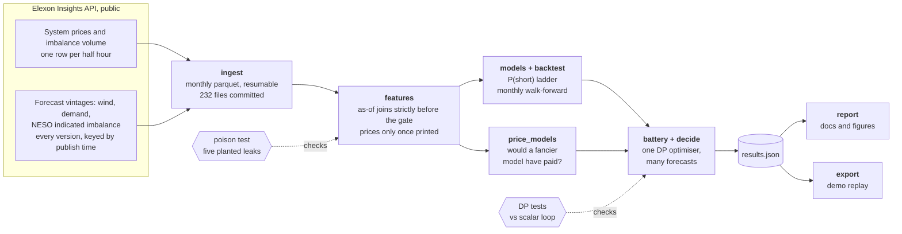

# Gate Closure

**Forecasting the GB grid's imbalance one hour ahead, and pricing what that forecast is worth.**

Every half hour the GB electricity system is either short of power or long. Whoever is on the wrong side pays the imbalance price, which nobody knows until about twenty minutes after the half hour ends. One hour before each half hour, at gate closure, we forecast which side the grid will be on, using only data that was public at that moment. A simulated 1 MW / 2 MWh battery trades on the forecast.

Built in 24 hours at OxHack '26 (Oxford, 24 to 25 October 2026) for HRT's challenge: *best use of data for predictions and decision making*. The theme of the hack was time; this project is about the one hour between deciding and knowing.

## The answer

Walk-forward over four years (July 2022 to June 2026, refitted monthly, 70,120 half hours), with 90% intervals from resampling whole weeks:

- **The forecast is clearly better than the baselines.** Our probability of a short system scores Brier 0.2293. Calibrated persistence scores 0.2409 and NESO's own published imbalance forecast 0.2468. Paired over the same weeks, ours is better by 0.0117 [0.0106, 0.0127].
- **It is worth a little money, and we can say exactly how much.** The battery earns £42.9 a day on a fixed daily schedule and £48.3 with our forecast: a gain of £5.4 a day [1.0, 9.7]. Persistence and NESO's forecast both lose money against the schedule.
- **There is an exchange rate between accuracy and money.** Scale the forecast's errors up or down and the money moves almost linearly: £8 to £10 a day per 0.01 of Brier. The line crosses the no-forecast schedule at about Brier 0.235. Trading on a coin-flip-quality forecast loses £13 to £19 a day against simply not forecasting. So the first slice of skill only pays for the right to act on a forecast at all. That is why a clearly better forecast earns only £5 more.

<picture>
  <source media="(prefers-color-scheme: dark)" srcset="docs/value_of_skill_dark.svg">
  
</picture>

For scale, knowing the side of every half hour an hour early would earn £223 a day, and knowing every price in advance £345. A boosted-tree classifier beats our logistic model on Brier but not on money (£48.2 to £50.0 depending on the machine, against £48.3), so the simple model ships. Forecasting the price directly earns less than the fixed schedule.

Every table, interval and robustness check is in [docs/RESULTS.md](docs/RESULTS.md), generated from the pipeline's output.

## One decision, in time

```
   T-150    T-120     T-90     T-60     T-30       T      T+30
     │  t-5   │  t-4   │  t-3   │  t-2   │  t-1   │   t    │
     └────────┴────────┴────────┼────────┴────────┴────────┘
                                ▲
                                gate closure: the decision for period t is made here

     t-4's price prints about 52 min after it starts (T-68)    used
     t-3's price prints about 52 min after it starts (T-38)    not yet public, never used
     wind, demand and NESO forecasts                           newest version published strictly before T-60
```

Everything in the project bends around this picture. A feature is either provably public at the gate or it does not exist.

## Architecture



### Design decisions

1. **One clock.** Every timing rule (the gate, the price lag, when prices print) is a named constant in [`gclose/__init__.py`](gclose/__init__.py), shared by the features, the training windows, the optimiser and the tests. There is no second definition to drift.
2. **Point-in-time by construction.** Forecast vintages join with a single `merge_asof` per dataset, matched to their own target period and strictly before the gate. Prices are used only once they have printed. Each monthly refit learns only from outcomes that were public at that month's first gate.
3. **One optimiser, many forecasts.** The battery's dynamic programme is fixed, and forecasts are swapped in. So a difference in money is the forecast's doing, not the optimiser's. Fed only the base rate, the forecast-driven policy takes exactly the schedule's actions on all 70,120 half hours, and a test pins that identity.
4. **Vectorise what does not depend on the path.** The value of each state of charge depends only on prices, so the Bellman step runs across every half hour at once in numpy. Only the battery's path, with its daily loss limit, is a loop. The feature build went from 123 s to 12 s and the whole decision study runs in 5 s, each checked to reproduce the slower version's output exactly.
5. **Uncertainty on every headline.** Intervals resample whole weeks, because a windy week is windy all week. Comparisons are resampled in pairs, so an interval describes the difference, not two independent noises.
6. **Tests that try to break it.** The poison test replaces everything published after a cutoff with noise, with a cutoff one minute before every publication, and checks that nothing decided earlier changes. To prove it can fail, it also plants five leaks (late prints ignored, a one-period price lag, gates at 45, 30 and 0 minutes) and requires each one to be caught.

## Honesty

- **Pre-registered.** [`PROTOCOL.md`](PROTOCOL.md) fixed the question, baselines, battery, metrics and failure condition before any result existed. Every later change is a dated amendment saying what changed, why, and its effect, including the ones found by an independent code review.
- **Held out.** July to October 2026 is sealed. It is opened once, after the model is frozen.
- **Known limitation.** From February 2024 Elexon serves each price as revised the next day, and the first print is not kept. In that era our price-based inputs use revised values that were not public at the gate (the timing rule itself is still enforced). We report both eras: before the switch, with clean first prints, ours beats the schedule by £9.4 a day and persistence by 0.0127 Brier; after it, by £2.7 and 0.0110.
- **Reproducible.** The raw data is committed, so every number rebuilds offline. Two machines agree to the decimal on everything except the boosted model, which moves by up to £2 a day with floating-point differences in tree building.

## Reproduce

Python 3.11 or later, any OS. About three minutes from a clean clone, with no network: the raw data is in the repo.

```
pip install -e ".[dev]"            # or: pip install -r requirements.txt
make reproduce                     # or run the lines below in order

python -m pytest -q                # 12 tests, about 15 s
python -m gclose.features          # gate-safe feature table from data/raw (12 s)
python -m gclose.backtest          # walk-forward forecasts, Brier and log loss
python -m gclose.price_models      # the boosted and ridge checks (1.5 min)
python -m gclose.decide            # the battery under every forecast, with intervals
python -m gclose.report            # docs/RESULTS.md and the figures
python -m gclose.export            # demo data, and the poison check on a real week
```

`make lint` runs ruff's linter and formatter check. To refresh the data from Elexon (public API, no key):
`python -m gclose.ingest check`, then `python -m gclose.ingest pull 2022-01-01 2026-10-23`.

## Repository

```
PROTOCOL.md              the pre-registration and its dated amendments
gclose/__init__.py       everything the protocol fixes: paths, timing rules, test windows
gclose/ingest.py         Elexon client and raw store: monthly parquet under data/raw/, resumable
gclose/features.py       gate-safe features: as-of joins for forecasts, print times for prices
gclose/models.py         the P(short) ladder: coin, persistence, NESO's forecast, ours
gclose/backtest.py       the walk-forward driver, and forecast scores
gclose/price_models.py   would a fancier model have paid? ridge and boosted, same driver
gclose/battery.py        the battery: vectorised dynamic programme, sequential path
gclose/decide.py         one optimiser, many forecasts: money, ceilings, robustness, value of skill
gclose/stats.py          week-block bootstrap and paired intervals, vectorised
gclose/receipts.py       the poison check end to end on a real week
gclose/report.py         docs/RESULTS.md and the figures, rendered from results.json
gclose/figures.py        README figures in light and dark
gclose/export.py         replay data for the demo
gclose/store.sql         a TimescaleDB sketch for the Tiger Data track (not used by the pipeline)
tests/                   the poison test with planted leaks; the optimiser against a scalar loop
data/raw/                Elexon data, January 2022 to October 2026
web/                     demo (in progress)
```

## Data

Elexon Insights API: `/balancing/settlement/system-prices/{date}` for prices and net imbalance volume, and `/datasets/WINDFOR`, `/datasets/NDF` and `/datasets/IMBALNGC` queried by publish window for forecast vintages. Contains BMRS data © Elexon Limited copyright and database right 2026, used under the BMRS Data Licence.

Prior work by the author (an RMT spurious-factor paper, a systematic-trading repository) is cited for context only; no code from it is used. Nothing from Cabestan Quant Research is used.
